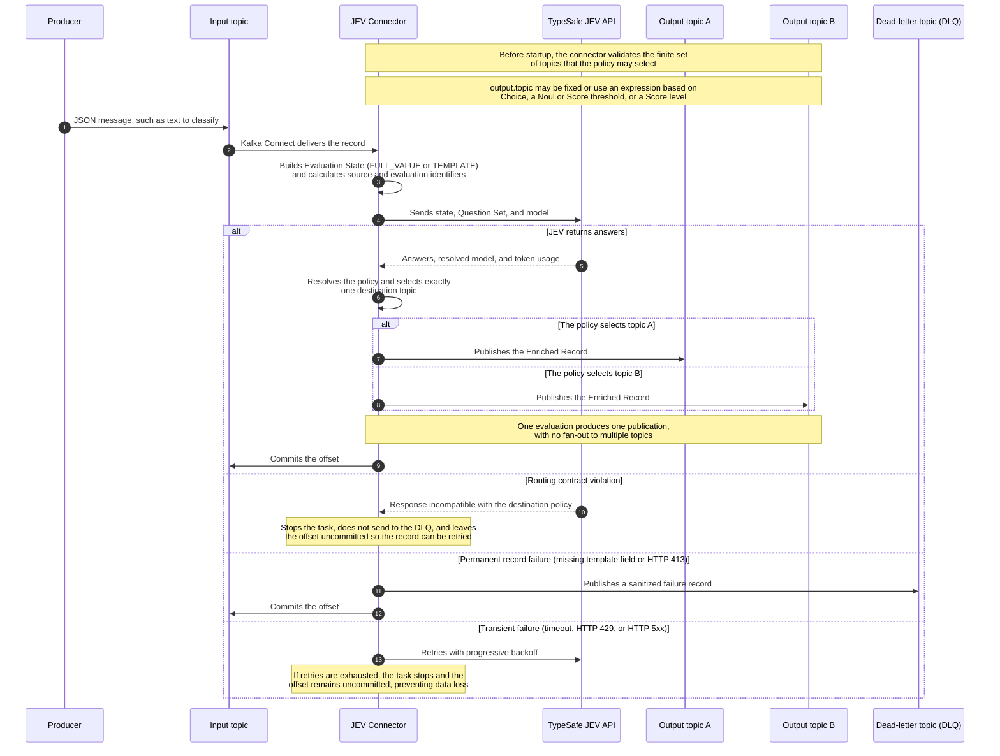

# Classifying and Routing Real-Time Events with Kafka Connect and JEV

ChatGPT was announced in 2022, ushering in the era of LLMs and Generative AI as mainstream technologies accessible to all kinds of users, businesses, and use cases.

However, using LLMs in real-time, event-driven applications—a primary use case for Kafka—presents several challenges: high latency, hallucinations, unpredictable output formats, and cost.

It is true that all these areas have improved since then. Still, even when technically feasible, using LLMs with events is not the most efficient approach for a large share of use cases.

> The main goal of using AI in real time is to **automate decisions.**

We may eventually generate a customer response, create a ticket, or perform another action involving text. But first, there was a decision. Is it critical? Is it a failure? Is it urgent? Does it look like fraud? Which team is responsible?

Automating these seemingly small decisions is what enables organizations to scale business processes, improve customer experience, and optimize effort.

In this article, we will:

- Consume support tickets from a Kafka topic.
- Classify them with JEV.
- Enrich each event with the decisions.
- Route them to different topics.

## JEV

In September 2026, TypeSafe.ai announced JEV, a family of models designed to produce decisions rather than text. It offers several advantages that are particularly relevant when working with events:

- Latency: It does not need to generate tokens that depend on previous tokens, so it can process each question in parallel. This results in much lower latency than LLMs.
- Fewer hallucinations: Each question is classified several times in parallel to reduce variation and produce an average classification. It is not deterministic, but it is less prone to hallucinations.
- Structure: The output format is not produced through token generation, so it does not vary. We know what to expect from the model response and do not need to validate its shape.
- Cost: Only input tokens are charged, at USD 0.042 per million tokens. By comparison, GPT-5 nano costs USD 0.05 per million input tokens and USD 0.20 per million output tokens.

With these attributes, especially its low cost and latency, JEV becomes a strong option for connecting a decision model to events received by Kafka. This brings us to...

## Kafka-JEV-Connector

The connector is open source and available in the [kafka-jev-connector](https://github.com/smatiolids/kafka-jev-connector) repository.

Straight to the point, Kafka-JEV-Connector consumes messages from selected topics, builds context from their payloads, and submits it to JEV.

The connector publishes the result to an output topic or to a DLQ when a permanent record failure occurs. JEV can also determine the output topic, effectively acting as a message router.

## How It Works



## Hands On

Now that we know what the connector does, let's put it to work.

The complete scenario, including configuration files, the local environment, and all supporting scripts, is available in the [kafka_jev_demo](https://github.com/smatiolids/kafka_jev_demo) repository.

In this example, we will read support tickets from the `messages` topic, send them to JEV, and publish the results to one or more topics prefixed with `messages_jev`.

Before doing that, we need to define two things: Which questions do we want to ask, and which event data should be used to answer them?

### Configuring the Questions

The questions live in `config/questions.json`. The connector does not read this file directly, but it keeps the questions editable without forcing us to work with JSON embedded inside another JSON document.

Each property represents a question. Its name also becomes the answer identifier used in both the result and the routing rules.

Our example contains six questions:

- Does the ticket require human intervention?
- Is there a cancellation risk?
- Which department should handle it?
- What is the customer's intent?
- How urgent is it?
- What is the level of customer dissatisfaction?

We use three question types to answer them: `noul`, `choice`, and `score`.

#### Noul

The `noul` type represents a decision between true and false, but it returns a continuous value between `0` and `1`.

The closer the value is to `1`, the more closely the content matches the true criterion. The closer it is to `0`, the more closely it matches the false criterion.

```json
"requires_human": {
  "type": "noul",
  "instructions": "Does this ticket require human intervention?",
  "criteria": {
    "true": "The issue cannot be safely resolved by an automated response or requires a privileged action.",
    "false": "The issue can follow the normal automated flow."
  }
}
```

Here, we do more than ask whether the ticket needs a person. We also explain what true and false mean within our process.

#### Choice

The `choice` type is used when we have a closed set of answers. For `department`, for example, JEV must select exactly one of the teams defined in `criteria`.

```json
"department": {
  "type": "choice",
  "instructions": "Which team should be primarily responsible for this ticket?",
  "criteria": {
    "billing": "Charges, payments, invoices, or refunds.",
    "technical_support": "Technical failures, access, or product functionality.",
    "account_security": "Locked account, credentials, fraud, or suspicious access.",
    "retention": "Cancellation, serious dissatisfaction, or risk of losing the customer.",
    "general_support": "Matters that do not clearly belong to the other teams."
  }
}
```

The `billing`, `technical_support`, and other keys are part of the contract. Later, we will use them to determine the destination topic.

#### Score

Finally, the `score` type places the event on an ordered scale.

```json
"urgency": {
  "type": "score",
  "instructions": "Rate the operational urgency of the ticket.",
  "criteria": [
    "Can wait for the normal flow.",
    "Should be handled this week.",
    "Should be handled today.",
    "Requires immediate attention to avoid significant impact."
  ]
}
```

Because there are four criteria, the levels range from `0` to `3`. In addition to the level, JEV returns a continuous score that lets us define more precise thresholds.

This difference will matter when we configure routing. We can use the level defined by the scale or compare the score value directly.

### Adding the Questions to the Connector

Kafka Connect receives configuration properties as simple values. Therefore, the questions object must be serialized and included in `jev.questions`.

To avoid doing this by hand, the project includes the following script:

```bash
python3 config/set_questions.py
```

It reads `questions.json` and updates `jev.questions` in `config/connector.json`.

The `connector-local*.json` files already contain the same version of the questions. If you change `questions.json`, you must also update the local configuration file you intend to run.

In addition to the questions, we have `question.set.id`:

```json
{
  "question.set.id": "message_classification/v1"
}
```

It identifies the set used for that evaluation. If a question or criterion changes, we should create a new version, such as `message_classification/v2`.

This allows us to distinguish a result produced by the current questions from one produced by an earlier version.

### Building the State

Questions define what we want to know. State defines what JEV needs to know to answer.

The connector can build this state in two ways: Send the entire event value or construct text dynamically.

#### Full Value

With `FULL_VALUE`, the entire message value is sent to JEV:

```json
{
  "state.mode": "FULL_VALUE"
}
```

This is the simplest option. If the value is an object or list, it is converted to JSON. If it is a string, it is sent as text.

However, we do not always want to send the entire event. It may contain irrelevant fields, sensitive information, or simply fail to give the model enough context.

For these situations, we have `TEMPLATE` mode.

#### Template

The demo uses this template:

```json
{
  "state.mode": "TEMPLATE",
  "state.template": "Ticket: ${key}\nSubject: ${value:/subject:-(no subject)}\nMessage: ${value:/body:-(no message)}"
}
```

For every message, the connector replaces the expressions with values from that record.

If the key is `ticket-42`, the subject is `Payment failed`, and the body is `My card was charged twice`, JEV receives:

```text
Ticket: ticket-42
Subject: Payment failed
Message: My card was charged twice
```

It is a small but important difference. We are not sending only JSON. We explain what each piece of information represents and choose exactly which fields leave Kafka.

We can build State from:

| Expression | Content |
| --- | --- |
| `${value}` | Complete message value |
| `${key}` | Complete message key |
| `${value:/customer/name}` | Value field selected with JSON Pointer |
| `${key:/tenant/id:-unknown}` | Key field with a default value |
| `${header:trace-id}` | Last header with this name |
| `${metadata:topic}` | Source topic |
| `${metadata:partition}` | Source partition |
| `${metadata:offset}` | Source offset |
| `${metadata:timestamp}` | Record timestamp |

The `:-` fragment defines a default value. In `${value:/subject:-(no subject)}`, `(no subject)` is used when the field is missing or contains `null`.

Without a default, a missing reference is treated as a permanent failure and the record is sent to the DLQ.

> Template mode lets us turn every event into dynamic context without writing another Kafka consumer.

### Configuring the Connector

With Questions and State defined, we can configure the rest of the connector.

```json
{
  "connector.class": "io.github.smatiolids.kafkajev.JevSinkConnector",
  "tasks.max": "1",
  "topics": "messages",
  "output.topic": "messages_jev",
  "errors.deadletter.topic": "messages_jev_dlq",
  "output.bootstrap.servers": "${env:KAFKA_BOOTSTRAP_SERVERS}",
  "jev.api.key": "${env:TYPESAFE_API_KEY}",
  "jev.endpoint": "https://api.typesafe.ai/v1/systemone",
  "jev.model": "jev-latest",
  "question.set.id": "message_classification/v1",
  "state.mode": "TEMPLATE",
  "state.template": "Ticket: ${key}\nSubject: ${value:/subject:-(no subject)}\nMessage: ${value:/body:-(no message)}",
  "behavior.on.null.values": "IGNORE"
}
```

`topics` defines where events are consumed from. `errors.deadletter.topic` defines the DLQ. Despite its name, `output.topic` defines the entire routing policy.

This is where things get interesting.

### Routing the Events

The project contains one `connector-local*.json` file for each routing option. To switch between them, change `CONNECTOR_CONFIG_FILE` in `.env`.

Before looking at the options, there is one important rule: The connector does not create topics.

Every possible destination must exist before startup. Because Questions have finite answers, the connector can calculate and validate these topics in advance.

To make it easy to switch between examples, we will create all topics at once. They are divided into the following groups:

| Group | Scenario | File | Topics |
| --- | --- | --- | --- |
| Input | All | All | `messages` |
| Fixed output | Fixed topic | `connector-local.json` | `messages_jev` |
| Department | Choice | `connector-local-router-by-choice.json` | `messages_jev_billing`, `messages_jev_technical_support`, `messages_jev_account_security`, `messages_jev_retention`, `messages_jev_general_support` |
| Intervention | Noul | `connector-local-router-by-noul.json` | `messages_jev_to_human`, `messages_jev_to_agent` |
| Urgency | Score value | `connector-local-router-by-score-value.json` | `messages_jev_urgent`, `messages_jev_normal` |
| Dissatisfaction | Score level | `connector-local-router-by-score-level.json` | `messages_jev_dissatisfaction_0`, `messages_jev_dissatisfaction_1`, `messages_jev_dissatisfaction_2`, `messages_jev_dissatisfaction_3` |
| Failures | All | All | `messages_jev_dlq` |

With all of them available, we can switch only the connector configuration file without recreating the topic infrastructure.

#### Fixed Topic

Let's start with the simplest case, defined in `config/connector-local.json`:

```json
{
  "output.topic": "messages_jev"
}
```

Every successfully evaluated ticket is published to `messages_jev`. The answers enrich the event but do not affect its destination.

#### Routing by Choice

Now we will use the `department` answer to choose the topic. This configuration is in `config/connector-local-router-by-choice.json`:

```json
{
  "output.topic": "messages_jev_${answers.department.choice}"
}
```

If JEV chooses `billing`, the event goes to `messages_jev_billing`. If it chooses `technical_support`, the event goes to `messages_jev_technical_support`.

The same applies to every alternative defined in `department.criteria`.

In this case, JEV does more than classify the ticket. It decides which flow should process it.

#### Routing by Noul

Not every decision has several categories. Some are closer to a yes-or-no question.

In `config/connector-local-router-by-noul.json`, we use `requires_human` to separate what needs a person from what can continue to an agent:

```json
{
  "output.topic": "messages_jev_${answers.requires_human.noul > 0.8; \"to_human\", \"to_agent\"}"
}
```

If the value is greater than `0.8`, the destination is `messages_jev_to_human`. Otherwise, it is `messages_jev_to_agent`.

The `0.8` threshold is our decision, not the model's. We can make it more or less conservative depending on the impact of routing a ticket incorrectly.

Conditional expressions also accept `>=`, `<`, and `<=`.

#### Routing by Score Value

The same type of comparison can be applied to a `score` question.

In `config/connector-local-router-by-score-value.json`, tickets with urgency above `2` are sent to a priority flow:

```json
{
  "output.topic": "messages_jev_${answers.urgency.score > 2 ; \"urgent\", \"normal\"}"
}
```

The result is either `messages_jev_urgent` or `messages_jev_normal`.

Because the score is continuous, we can define the cutoff that makes sense for the business, even when it falls between two levels in the scale.

#### Routing by Score Level

We can also use the levels defined in `criteria` directly.

In `config/connector-local-router-by-score-level.json`, each dissatisfaction level gets its own topic:

```json
{
  "output.topic": "messages_jev_dissatisfaction_${answers.customer_dissatisfaction.level}"
}
```

Because `customer_dissatisfaction` contains four criteria, the possible destinations end in `0`, `1`, `2`, or `3`.

This option is useful when we want to preserve every category in the scale rather than reduce it to only two paths.

In all these examples, one evaluation produces one publication. The connector selects one destination; it does not distribute the same result to several topics.

### Running Locally

To run the demo, create a `.env` file with the local addresses and your TypeSafe API key:

```dotenv
KAFKA_BOOTSTRAP_SERVERS=127.0.0.1:9092
CONNECT_KAFKA_BOOTSTRAP_SERVERS=kafka:29092
CONNECT_WORKER_CONFIG_FILE=./config/connect-distributed-local.properties
CONNECTOR_CONFIG_FILE=./config/connector-local.json

KAFKA_API_KEY=
KAFKA_API_SECRET=
KAFKA_SSL_CA_LOCATION=
TYPESAFE_API_KEY=<your TypeSafe API key>

BOOTSTRAP_SERVERS=kafka:29092
CREATE_TOPICS=messages,messages_jev,messages_jev_billing,messages_jev_technical_support,messages_jev_account_security,messages_jev_retention,messages_jev_general_support,messages_jev_to_human,messages_jev_to_agent,messages_jev_urgent,messages_jev_normal,messages_jev_dissatisfaction_0,messages_jev_dissatisfaction_1,messages_jev_dissatisfaction_2,messages_jev_dissatisfaction_3,messages_jev_dlq
```

All topics are created during the first startup. To change the scenario, we only need to change the file in `CONNECTOR_CONFIG_FILE`.

Then start Kafka and Kafka Connect:

```bash
docker compose -f compose.kafka.yaml -f compose.yaml up -d --build --wait
```

We can check the connector status through the Kafka Connect API:

```bash
curl --fail --silent localhost:8083/connectors/jev/status
```

With the connector running, install the Python dependencies and send ten tickets:

```bash
python3 -m venv .venv
.venv/bin/pip install -r requirements.txt
.venv/bin/python helper/send_message.py --limit 10
```

Each ticket represents one call to JEV. For this reason, it is a good idea to start with a small number before sending the complete dataset.

To follow the results:

```bash
.venv/bin/python helper/receive_messages.py --from-beginning --pretty
```

The script listens to every topic whose name starts with `messages_jev` and shows which topic received each record.

### Execution Results

To validate the scenario, we processed all 4,000 tickets in the dataset with each of the five output configurations.

This produced 4,000 input messages and 20,000 Enriched Records, with 4,000 for each policy. In total, 24,000 events passed through the observed topics.

Every evaluation used the resolved model `jev-1.14.0`.

The complete results are available in [`docs/results.txt`](results.txt) and can be generated again with:

```bash
.venv/bin/python helper/summarize_results.py
```

#### Routing Results

Each policy processed the same 4,000 tickets but produced a different view of the dataset:

| Scenario | Distribution |
| --- | --- |
| Fixed | 4,000 in `messages_jev` |
| Choice | 3,237 `technical_support`, 414 `billing`, 341 `general_support`, 7 `account_security`, and 1 `retention` |
| Noul | 2,203 `to_agent` and 1,797 `to_human` |
| Score value | 2,427 `normal` and 1,573 `urgent` |
| Score level | 927 at level `0`, 1,945 at level `1`, 1,128 at level `2`, and none at level `3` |
| DLQ | No records |

Each scenario ran a new evaluation. Because the result is not deterministic, small differences between the fixed-topic distribution and the routed-topic distributions are expected.

The `department` result is heavily concentrated. `technical_support` received 80.9% of the tickets, while `account_security` and `retention` appeared only a few times.

The average `requires_human` value was `0.74`. If we used `0.5` as the threshold, 90.1% of the tickets would be considered true.

However, our rule uses `0.8`. With this threshold, 1,797 tickets were sent for human assistance and 2,203 continued to the agent.

This is a good example of the separation between the model and the business rule. JEV produces the value; we decide at which point that value changes the event's path.

The same applies to urgency. With `score > 2`, 1,573 tickets, or 39.3% of the total, were published to `messages_jev_urgent`.

#### Latency, Scale, and Cost

Across the 20,000 evaluations, JEV call latency was:

| Metric | Latency |
| --- | ---: |
| Average | 210 ms |
| p50 | 201 ms |
| p95 | 279 ms |
| p99 | 329 ms |
| Maximum | 1,518 ms |

In other words, 95% of calls completed within 279 ms. Even after processing the 4,000 tickets five times, all 20,000 evaluations finished on the first attempt, and none went to the DLQ.

The 20,000 evaluations consumed 20,002,245 input tokens and 3,737,920 output tokens, for an average of 1,187 total tokens per record.

At the USD 0.042 per million input tokens used in the calculation, the complete run cost approximately USD 0.84.

| Projection | Estimated cost |
| --- | ---: |
| Per evaluation | USD 0.000042 |
| 1,000 evaluations | USD 0.042 |
| 1 million evaluations | USD 42.00 |

Because we ran five policies over the same tickets, the total cost represents five evaluations per original ticket. One pass over the 4,000 tickets would cost approximately USD 0.17 under the same conditions.

> For real-time use cases, this type of model combines three important characteristics: low per-event latency, the ability to process decisions at volume, and predictable cost as the workload scales.

This is not a universal benchmark, but the run demonstrates the profile well: 20,000 structured decisions, a p95 of 279 ms, no retries or DLQ records, and a total cost below one dollar.

When we do not need to generate text but instead classify, prioritize, or route an event, using a model specialized in decisions proves to be a highly efficient option.

#### What JEV Answered

The fixed topic lets us observe the distribution of all six answers across the 4,000 tickets:

| Question | Result |
| --- | --- |
| `requires_human` | Average `0.74`; 90.1% with a value greater than or equal to `0.5` |
| `cancellation_risk` | Average `0.04`; 1.6% with a value greater than or equal to `0.5` |
| `department` | 80.9% `technical_support`; average confidence of `0.93` |
| `customer_intent` | 52.5% `report_problem`; average confidence of `0.78` |
| `urgency` | Average score of `1.60`; average confidence of `0.72` |
| `customer_dissatisfaction` | Average score of `1.04`; average confidence of `0.77` |

These numbers tell us more than where the events went. They also help us evaluate whether the Questions and their criteria accurately represent the process we want to automate.

When switching the routing configuration, recreate the container so it mounts the new file:

```bash
docker compose -f compose.kafka.yaml -f compose.yaml up -d --build --wait --force-recreate
```

This allows us to change the routing logic without writing or deploying a new application. We update the Questions, State, or policy, restart the connector, and the new flow takes effect.
