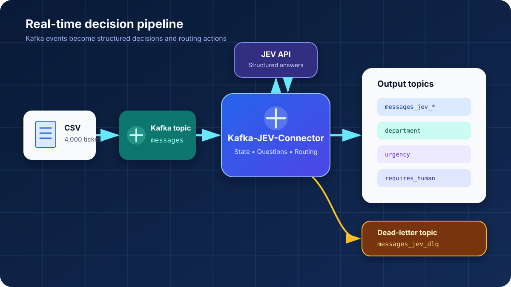
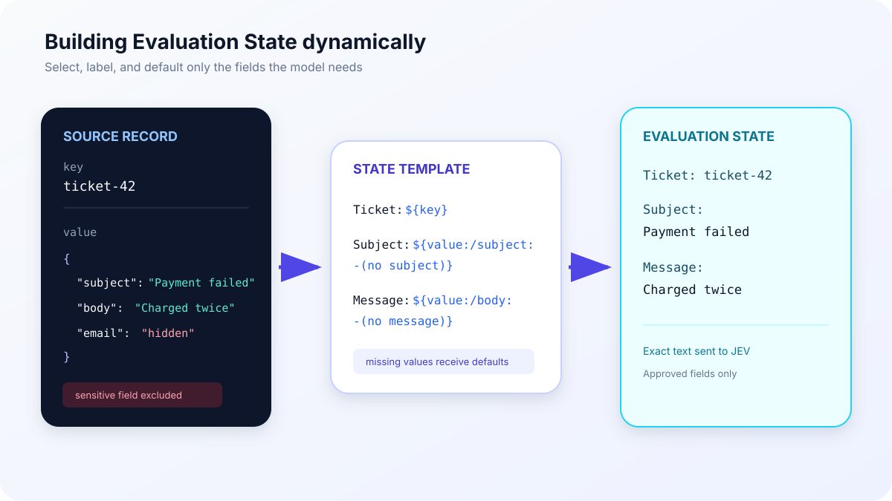
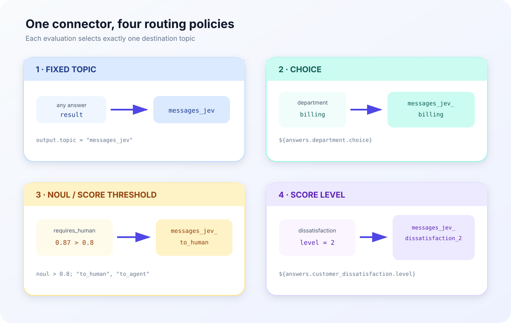
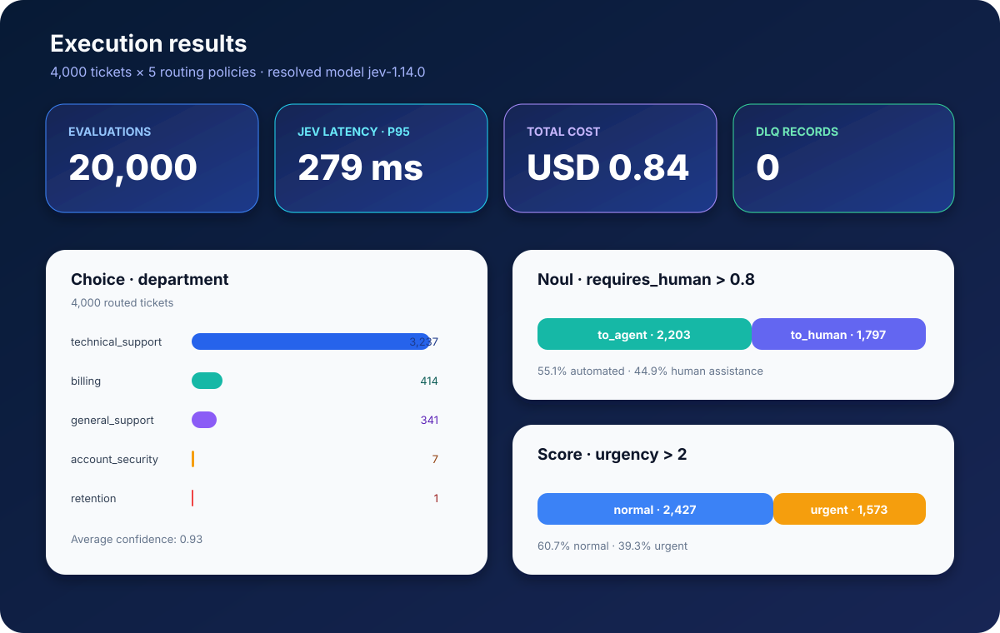

# Classifying and Routing Real-Time Events with Kafka Connect and JEV


If you have ever tried using LLMs in real-time, event-driven applications—a primary use case for Kafka—you know that we run into several challenges: high latency, hallucinations, unpredictable output formats, and cost.

It is true that all these areas have improved since then. Still, even when technically feasible, using LLMs with events is not the most efficient approach for a large share of use cases.

> The main goal of using AI in real time is to **automate decisions.**

We may eventually generate a customer response, create a ticket, or perform another action involving text. But first, there was a decision. Is it critical? Is it a failure? Is it urgent? Does it look like fraud? Which team is responsible?

Automating these seemingly small decisions is what enables organizations to scale business processes, improve customer experience, and optimize effort.

When JEV emerged as a decision model with lower latency and cost, I saw the ideal complement for expanding what we can do with Kafka and Generative AI. That is why I created a connector that integrates these technologies.

In this article, we will:

- Consume support tickets from a Kafka topic.
- Classify them with JEV.
- Enrich each event with the decisions.
- Route them to different topics.
- Understand the resulting cost and latency.

## JEV

In September 2026, TypeSafe.ai announced JEV, a family of models designed to produce decisions rather than text. It offers several advantages that are particularly relevant when working with events:

- Latency: It does not need to generate tokens that depend on previous tokens, so it can process each question in parallel. This results in much lower latency than LLMs.
- Fewer hallucinations: Each question is classified several times in parallel to reduce variation and produce an average classification. It is not deterministic, but it is less prone to hallucinations.
- Structure: The output format is not produced through token generation, so it does not vary. We know what to expect from the model response and do not need to validate its shape.
- Cost: Only input tokens are charged, at USD 0.042 per million tokens. By comparison, GPT-5 nano costs USD 0.05 per million input tokens and USD 0.20 per million output tokens.

With these attributes, especially its low cost and latency, JEV becomes a strong option for connecting a decision model to events received by Kafka. This brings us to...

## Kafka-JEV-Connector

Straight to the point, Kafka-JEV-Connector consumes messages from selected topics, builds context from their payloads, and submits it to JEV.

The result is then sent to output topics or to a DLQ in case of failures. The destination can be fixed or determined by JEV itself, meaning that JEV can act as a message router.



*A simplified view of the flow between the source, the model, and the destination topics.*

The connector is open source and available in the [kafka-jev-connector](https://github.com/smatiolids/kafka-jev-connector) repository.

## Hands On

The complete scenario, including configuration files, the local environment, and supporting scripts, is available in the [kafka_jev_demo](https://github.com/smatiolids/kafka_jev_demo) repository.

The connector is open source and available in the [kafka-jev-connector](https://github.com/smatiolids/kafka-jev-connector) repository.

We will send support tickets from a CSV file to the `messages` topic. The connector evaluates them and publishes the results to topics whose names start with `messages_jev`.

Before doing that, we need to define two things: Which questions do we want to ask, and which event data should be used to answer them?

### Configuring the Questions

The questions live in `config/questions.json`. Each property represents a Question, and its name becomes the identifier used in both answers and routing rules.

Our example contains six questions:

- Does the ticket require human intervention?
- Is there a cancellation risk?
- Which department should handle it?
- What is the customer's intent?
- How urgent is it?
- What is the level of customer dissatisfaction?

We use three question types to answer them: `noul`, `choice`, and `score`.

#### Noul

`noul` represents a decision between true and false, but it returns a continuous value between `0` and `1`.

```json
"requires_human": {
  "type": "noul",
  "instructions": "Does this ticket require human intervention?",
  "criteria": {
    "true": "The issue cannot be safely resolved by an automated response or requires a privileged action.",
    "false": "The issue can follow the normal automated flow."
  }
}
```

In addition to the question, we explain what true and false mean within our process.

#### Choice

`choice` is used when we have a closed set of answers. For `department`, JEV must select exactly one of the teams defined in `criteria`.

```json
"department": {
  "type": "choice",
  "instructions": "Which team should be primarily responsible for this ticket?",
  "criteria": {
    "billing": "Charges, payments, invoices, or refunds.",
    "technical_support": "Technical failures, access, or product functionality.",
    "account_security": "Locked account, credentials, fraud, or suspicious access.",
    "retention": "Cancellation, serious dissatisfaction, or risk of losing the customer.",
    "general_support": "Matters that do not clearly belong to the other teams."
  }
}
```

These keys are part of the contract and can be used directly in the destination topic name.

#### Score

`score` places the event on an ordered scale. The order of the criteria matters.

```json
"urgency": {
  "type": "score",
  "instructions": "Rate the operational urgency of the ticket.",
  "criteria": [
    "Can wait for the normal flow.",
    "Should be handled this week.",
    "Should be handled today.",
    "Requires immediate attention to avoid significant impact."
  ]
}
```

With four criteria, the levels range from `0` to `3`. JEV also returns a continuous score, allowing the policy to use the level or apply its own threshold.

### Adding the Questions to the Connector

Kafka Connect receives simple properties. Therefore, the Questions object must be serialized into `jev.questions`.

After editing `questions.json`, run:

```bash
python3 config/set_questions.py
```

The script updates `jev.questions` in `config/connector.json`.

### Building the State

If Questions define what we want to know, State defines the context JEV uses to answer.

The connector can send the entire event value or build this context dynamically.

#### Full Value

With `FULL_VALUE`, the entire message value is sent to JEV:

```json
{
  "state.mode": "FULL_VALUE"
}
```

This is the simplest option, but it may include irrelevant or sensitive data. To select only the required fields, we use `TEMPLATE`.

#### Template

The demo template is:

```json
{
  "state.mode": "TEMPLATE",
  "state.template": "Ticket: ${key}\nSubject: ${value:/subject:-(no subject)}\nMessage: ${value:/body:-(no message)}"
}
```

For every message, the connector replaces the expressions with values from the record:

```text
Ticket: ticket-42
Subject: Payment failed
Message: My card was charged twice
```



The most common expressions are:

| Expression | Content |
| --- | --- |
| `${value}` | Complete message value |
| `${key}` | Complete key |
| `${value:/customer/name}` | Field selected with JSON Pointer |
| `${metadata:topic}` | Source topic |

We can also use headers, other metadata, and default values. The complete reference is available in the connector documentation.

Without a default value, a missing reference is a permanent failure and the record is sent to the DLQ.

### Configuring the Connector

With Questions and State defined, we only need the connector-specific properties:

```json
{
  "connector.class": "io.github.smatiolids.kafkajev.JevSinkConnector",
  "topics": "messages",
  "output.topic": "messages_jev",
  "errors.deadletter.topic": "messages_jev_dlq",
  "jev.api.key": "${env:TYPESAFE_API_KEY}",
  "jev.model": "jev-latest",
  "question.set.id": "message_classification/v1",
  "jev.questions": "<serialized questions.json>",
  "state.mode": "TEMPLATE",
  "state.template": "Ticket: ${key}\nSubject: ${value:/subject:-(no subject)}\nMessage: ${value:/body:-(no message)}"
}
```

`topics` defines the input, `errors.deadletter.topic` defines the DLQ, and `output.topic` defines the destination of processed messages.

### Routing the Events

The project contains one `connector-local*.json` file for each policy. To switch between them, change `CONNECTOR_CONFIG_FILE` in `.env`.

The connector does not create topics. Every destination must exist before startup.



#### Fixed Topic

```json
"output.topic": "messages_jev"
```

Every result is published to `messages_jev`. This is the best option when another consumer handles routing or when we want to keep a single stream.

#### Routing by Choice

```json
"output.topic": "messages_jev_${answers.department.choice}"
```

If `department` returns `billing`, the event goes to `messages_jev_billing`. This option is useful when each alternative represents a team or workflow.

#### Routing by Noul

```json
"output.topic": "messages_jev_${answers.requires_human.noul > 0.8; \"to_human\", \"to_agent\"}"
```

Values greater than `0.8` go to `messages_jev_to_human`; all others go to `messages_jev_to_agent`.

The threshold is a business rule. We can make it more or less conservative depending on the impact of an incorrect decision.

#### Routing by Score

We can compare the continuous value:

```json
"output.topic": "messages_jev_${answers.urgency.score > 2; \"urgent\", \"normal\"}"
```

Or use the scale level directly:

```json
"output.topic": "messages_jev_dissatisfaction_${answers.customer_dissatisfaction.level}"
```

The value lets us apply a custom threshold. The level preserves the categories defined by the Question criteria.

In every case, one evaluation produces one publication. The connector selects one destination; it does not distribute the same result to multiple topics.

### Running Locally

Download the plugin, create `.env`, and provide your TypeSafe API key. The complete configuration is in the [README](../README.md).

The properties we will change are:

```dotenv
TYPESAFE_API_KEY=<your TypeSafe API key>
CONNECTOR_CONFIG_FILE=./config/connector-local.json
```

Start Kafka and Kafka Connect:

```bash
docker compose -f compose.kafka.yaml -f compose.yaml up -d --build --wait
```

Check the connector:

```bash
curl --fail --silent localhost:8083/connectors/jev/status
```

Install the dependencies and send ten tickets:

```bash
python3 -m venv .venv
.venv/bin/pip install -r requirements.txt
.venv/bin/python helper/send_message.py --limit 10
```

Follow the results:

```bash
.venv/bin/python helper/receive_messages.py --from-beginning --pretty
```

### Execution Results

To validate the scenario, we processed all 4,000 tickets with each of the five policies. This produced 20,000 Enriched Records, all using the resolved model `jev-1.14.0`.



The complete results are in [`docs/results.txt`](results.txt) and can be generated again with:

```bash
.venv/bin/python helper/summarize_results.py
```

#### What the Routing Results Showed

Three results help explain the behavior of the policies:

- `technical_support` received 80.9% of tickets in `choice` routing.
- The `requires_human > 0.8` threshold sent 1,797 tickets to humans and 2,203 to the agent.
- The `urgency.score > 2` rule classified 1,573 tickets, or 39.3%, as urgent.

Each scenario ran a new evaluation. Because the result is not deterministic, small differences between the fixed output and routed outputs are expected.

The `requires_human` example shows the separation between the model and the business rule. JEV produces the value; we decide at which point it changes the event's path.

#### Latency, Scale, and Cost

Across the 20,000 evaluations, average JEV call latency was 210 ms. The p50 was 201 ms, the p95 was 279 ms, and the slowest call took 1,518 ms.

Every evaluation completed on the first attempt, and no records were sent to the DLQ.

The run consumed 20,002,245 input tokens and cost approximately USD 0.84. One pass over the 4,000 tickets would cost about USD 0.17 under the same conditions.

With the same profile, the estimated cost is USD 0.042 per thousand evaluations and USD 42.00 per million.

> For real-time use cases, this type of model combines low per-event latency, the ability to process decisions at volume, and predictable cost as the workload scales.

This is not a universal benchmark. Still, the run demonstrates the profile well: 20,000 structured decisions, a p95 of 279 ms, no additional attempts, no DLQ records, and a total cost below one dollar.

#### What JEV Answered

Three results stood out across the six Questions:

- `department`: 80.9% `technical_support`, with average confidence of `0.93`.
- `requires_human`: average value of `0.74`; 90.1% were above `0.5`.
- `cancellation_risk`: average of `0.04`; only 1.6% were above `0.5`.

These numbers help us evaluate whether the Questions and their criteria represent the process we want to automate. The complete distribution remains available in `results.txt`.

## Conclusions

My goal in creating this connector was to open the door to a new way of using models.

After understanding what JEV and similar models make possible, it became clear that combining them with Kafka could unlock use cases that are too slow or expensive to run at scale with LLMs.

If you use the connector, star the repo!
