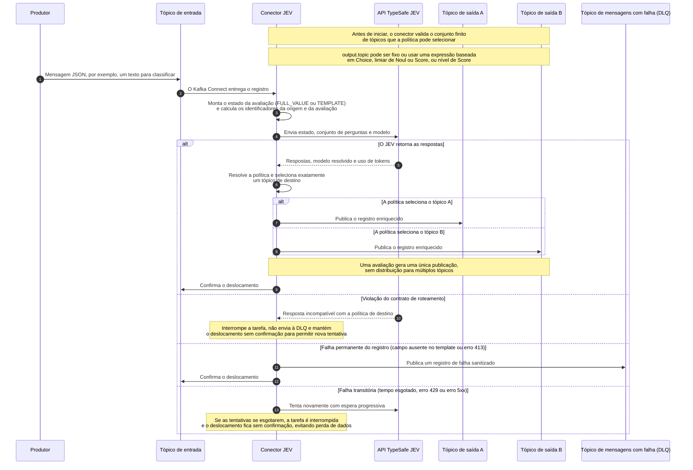

# Classificando e roteando eventos em tempo real com Kafka Connect e JEV

Se você já precisou utilizar LLMs em aplicações de tempo real orientadas a eventos, caso de uso principal do Kafka, sabe que esbarramos em algumas dificuldades, a saber: Alta latência, alucinações, formato de saída incerto e custo.

Sim, é verdade que todos estes pontos vêm evoluindo desde então, mas ainda que tecnicamente seja viável, para uma grande parcela de casos usar LLMs com eventos não é a maneira mais eficiente.

> O grande objetivo de se utilizar IA em tempo real é **automatizar decisões.**

Eventualmente iremos gerar uma resposta a um cliente, criar um ticket, ações que envolvem gerar texto. Mas, antes disso, houve uma decisão. É um caso crítico? É uma falha? É urgente? Parece ser uma fraude? Qual time é responsável?

É na automação destas decisões, aparentemente pequenas, que se escalam processos de negócio, melhora a experiência do cliente, otimiza o esforço.

Com o surgimento do JEV, modelo de decisão com latência e custo reduzido, vi o complemento ideal para ampliar o que podemos fazer com o Kafka e IA Generativa. Por isto, criei um connector que integra estas tecnologias.

Então neste artigo vamos:

- Consumir tickets de um tópico Kafka.
- Classificá-los com JEV.
- Enriquecer cada evento com as decisões.
- Roteá-los para tópicos diferentes.
- Entender o custo e latência atingidos.

## JEV

Em setembro de 2026 foi anunciado o JEV, família de modelos criada pela TypeSafe.ai, que tem como objetivo gerar decisões (e não texto) com alguns diferenciais relevantes para uso com eventos:

- Latência: Como ele não precisa gerar tokens que dependem dos tokens anteriores, ele pode paralelizar o processamento de cada questão. Com isso, a latência é muito menor comparadada aos LLMs.
- Menos alucinações: Não só as questões são processadas em paralelo, como cada questão é classificada várias vezes paralelamente para reduzir variações e chegar a uma classificacão média. Ainda não é determinístico, mas está menos sujeito a alucinações
- Estrutura: O formato de saída não é produzido via geração de tokens, logo não varia. Sabemos o que esperar com retorno do modelo e não é necessário validá-lo.
- Custo: Cobrado somente por tokens de entrada, possui um custo de USD 0.042 por milhão de tokens. Para comparação, o modelo gpt-5-nano, o mais barato atualmente, custa USD 0.05 por milhão de tokens de entrada, mas também cobra USD 0,20 por milhão de tokens de saída.

Com estes atributos, especialmente o baixo custo e baixa latência, o JEV se torna uma ótima opção para conectarmos uma modelo de decisão a eventos recebidos pelo Kafka. Para isto, chegamos ao...

## Kafka-JEV-Connector

Indo direto ao ponto, o Kafka-JEV-Connector consome mensagens de tópicos determinados, monta um contexto baseado no payload das mensagens e submete ao JEV, que retorna ao conector. Este resultado é então encaminhado aos tópicos de saída, assim como a tópico DLQ em caso de falhas. O tópico destino pode ser um específco, como pode ser determinado pelo JEV, ou seja, o JEV age como um roteador de mensagens.

O conector é open source e está disponível no repositório [kafka-jev-connector](https://github.com/smatiolids/kafka-jev-connector).

## Como Funciona



## Mão na massa

Agora que sabemos o que o conector faz, vamos colocá-lo para funcionar.

Todo o cenário, incluindo os arquivos de configuração, o ambiente local e os scripts utilizados, está descrito no repositório [kafka_jev_demo](https://github.com/smatiolids/kafka_jev_demo).

Neste exemplo vamos enviar dados de um arquivo CSV com tickets de suports, enviá-lo ao tópico `messages`. O connector vai enviá-los ao JEV e publicar o resultado em um ou mais tópicos com o prefixo `messages_jev`.

Antes disso, precisamos definir duas coisas: Quais perguntas queremos fazer e quais dados do evento serão utilizados para respondê-las.

### Configurando as Questions

As perguntas estão no arquivo `config/questions.json`. Este arquivo não é lido diretamente pelo conector, mas mantém as perguntas em um formato que conseguimos editar sem lidar com um JSON dentro de outro JSON.

Cada propriedade representa uma pergunta. O nome da propriedade será também o identificador da resposta, utilizado tanto no resultado quanto nas regras de roteamento.

No nosso exemplo temos seis perguntas:

- O ticket precisa de intervenção humana?
- Existe risco de cancelamento?
- Qual departamento deve atendê-lo?
- Qual a intenção do cliente?
- Qual a urgência?
- Qual o nível de insatisfação?

Para respondê-las, utilizamos três tipos de questão: `noul`, `choice` e `score`.

#### Noul

O tipo `noul` representa uma decisão entre verdadeiro e falso, mas seu retorno é um valor contínuo entre `0` e `1`.

```json
"requires_human": {
  "type": "noul",
  "instructions": "Does this ticket require human intervention?",
  "criteria": {
    "true": "The issue cannot be safely resolved by an automated response or requires a privileged action.",
    "false": "The issue can follow the normal automated flow."
  }
}
```

Aqui não perguntamos apenas se o ticket precisa de uma pessoa. Também explicamos ao modelo o que consideramos verdadeiro e falso dentro do nosso processo.

#### Choice

O tipo `choice` é utilizado quando temos um conjunto fechado de respostas. Para `department`, por exemplo, o JEV deverá escolher exatamente uma das áreas definidas em `criteria`.

```json
"department": {
  "type": "choice",
  "instructions": "Which team should be primarily responsible for this ticket?",
  "criteria": {
    "billing": "Charges, payments, invoices, or refunds.",
    "technical_support": "Technical failures, access, or product functionality.",
    "account_security": "Locked account, credentials, fraud, or suspicious access.",
    "retention": "Cancellation, serious dissatisfaction, or risk of losing the customer.",
    "general_support": "Matters that do not clearly belong to the other teams."
  }
}
```

As chaves `billing`, `technical_support` e as demais são parte do contrato. Mais adiante iremos utilizá-las para definir o tópico de destino.

#### Score

Por fim, o tipo `score` posiciona o evento dentro de uma escala ordenada. Atenção, a ordem é importante!

```json
"urgency": {
  "type": "score",
  "instructions": "Rate the operational urgency of the ticket.",
  "criteria": [
    "Can wait for the normal flow.",
    "Should be handled this week.",
    "Should be handled today.",
    "Requires immediate attention to avoid significant impact."
  ]
}
```

Como temos quatro critérios, os níveis vão de `0` a `3`. Além do nível, o JEV retorna um score contínuo que nos permite criar limites mais precisos.

Esta diferença será útil no roteamento. Podemos utilizar o nível definido na escala ou comparar diretamente o valor do score.

### Adicionando as Questions ao conector

O Kafka Connect recebe as propriedades de configuração como valores simples. Então, o objeto de perguntas precisa ser serializado e incluído em `jev.questions`.

Para simplificar a edição das questões, após definir seu conjunto de questões no arquivo `questions.json`, execute o `set_questions.py` para atualizar o `config/connector.json`:

```bash
python3 config/set_questions.py
```

### Criando o State

Se as Questions definem o que queremos saber, o State define o que o JEV precisa saber para responder, o que em IA Generativa chamamos de contexto.

O conector possui duas maneiras de criar este estado: Enviar o valor completo do evento ou montar um texto dinamicamente.

#### Full Value

Com `FULL_VALUE`, todo o valor da mensagem é enviado ao JEV:

```json
{
  "state.mode": "FULL_VALUE"
}
```

É a opção mais simples. Se o valor for um objeto ou uma lista, ele será transformado em JSON. Se for uma string, será enviado como texto.

Porém nem sempre queremos enviar todo o evento. Ele pode conter campos irrelevantes, informações sensíveis ou simplesmente não dar contexto suficiente ao modelo. Para estes casos temos o modo `TEMPLATE`.

#### Template

O template utilizado na demonstração é:

```json
{
  "state.mode": "TEMPLATE",
  "state.template": "Ticket: ${key}\nSubject: ${value:/subject:-(no subject)}\nMessage: ${value:/body:-(no message)}"
}
```

A cada mensagem, o conector substitui as expressões pelos valores daquele registro.

Se a chave for `ticket-42`, o assunto for `Payment failed` e o corpo for `My card was charged twice`, o JEV receberá:

```text
Ticket: ticket-42
Subject: Payment failed
Message: My card was charged twice
```

É uma diferença pequena, mas importante. Não enviamos apenas um JSON. Explicamos o que cada informação representa e escolhemos exatamente quais campos deixam o Kafka.

Podemos construir o State a partir de:

| Expressão | Conteúdo |
| --- | --- |
| `${value}` | Valor completo da mensagem |
| `${key}` | Chave completa da mensagem |
| `${value:/customer/name}` | Campo do valor usando JSON Pointer |
| `${key:/tenant/id:-unknown}` | Campo da chave com valor padrão |
| `${header:trace-id}` | Último header com este nome |
| `${metadata:topic}` | Tópico de origem |
| `${metadata:partition}` | Partição de origem |
| `${metadata:offset}` | Offset de origem |
| `${metadata:timestamp}` | Timestamp do registro |

O trecho `:-` define um valor padrão. Em `${value:/subject:-(no subject)}`, usamos `(no subject)` quando o campo não existe ou possui valor `null`.

Sem um valor padrão, uma referência ausente é considerada uma falha permanente e o registro é enviado à DLQ.

> O Template nos permite transformar cada evento em um contexto dinâmico sem escrever um novo consumidor Kafka.

### Configurando o conector

Com as Questions e o State definidos, podemos configurar o restante do conector. Aqui vale tudo o que vc já conhece sobre connectors.

```json
{
  "connector.class": "io.github.smatiolids.kafkajev.JevSinkConnector",
  "tasks.max": "1",
  "topics": "messages",
  "output.topic": "messages_jev",
  "errors.deadletter.topic": "messages_jev_dlq",
  "output.bootstrap.servers": "${env:KAFKA_BOOTSTRAP_SERVERS}",
  "jev.api.key": "${env:TYPESAFE_API_KEY}",
  "jev.endpoint": "https://api.typesafe.ai/v1/systemone",
  "jev.model": "jev-latest",
  "question.set.id": "message_classification/v1",
  "state.mode": "TEMPLATE",
  "state.template": "Ticket: ${key}\nSubject: ${value:/subject:-(no subject)}\nMessage: ${value:/body:-(no message)}",
  "behavior.on.null.values": "IGNORE"
}
```

Focando nas informações específicas deste connector, o `topics` define de onde os eventos serão consumidos. `errors.deadletter.topic` define a DLQ. Já `output.topic`, apesar do nome, define o destino das mensagens processadas.

### Roteando os eventos

O projeto de demonstração possui um arquivo `connector-local*.json` para cada possibilidade de roteamento. Para alternar entre elas, basta mudar `CONNECTOR_CONFIG_FILE` no `.env`.

Um ponto importante: O conector não cria tópicos. Então considere isso quanto estiver o utilizando em seus casos de uso.

Para facilitar a troca entre os exemplos, vamos criar todos os tópicos de uma única vez. Eles estão divididos nos seguintes grupos:

| Grupo | Cenário | Arquivo | Tópicos |
| --- | --- | --- | --- |
| Entrada | Todos | Todos | `messages` |
| Saída fixa | Tópico fixo | `connector-local.json` | `messages_jev` |
| Departamento | Choice | `connector-local-router-by-choice.json` | `messages_jev_billing`, `messages_jev_technical_support`, `messages_jev_account_security`, `messages_jev_retention`, `messages_jev_general_support` |
| Intervenção | Noul | `connector-local-router-by-noul.json` | `messages_jev_to_human`, `messages_jev_to_agent` |
| Urgência | Valor do Score | `connector-local-router-by-score-value.json` | `messages_jev_urgent`, `messages_jev_normal` |
| Insatisfação | Nível do Score | `connector-local-router-by-score-level.json` | `messages_jev_dissatisfaction_0`, `messages_jev_dissatisfaction_1`, `messages_jev_dissatisfaction_2`, `messages_jev_dissatisfaction_3` |
| Falhas | Todos | Todos | `messages_jev_dlq` |

Com todos eles disponíveis, podemos trocar somente o arquivo do conector sem precisar recriar a infraestrutura de tópicos.

#### Tópico fixo

Vamos começar pelo caso mais simples, presente em `config/connector-local.json`:

```json
{
  "output.topic": "messages_jev"
}
```

Todos os tickets avaliados são publicados em `messages_jev`. As respostas enriquecem o evento, mas não alteram seu destino.

#### Roteamento por Choice

Agora vamos utilizar a resposta de `department` para escolher o tópico. Esta configuração está em `config/connector-local-router-by-choice.json`:

```json
{
  "output.topic": "messages_jev_${answers.department.choice}"
}
```

Se o JEV escolher `billing`, o evento vai para `messages_jev_billing`. Se escolher `technical_support`, vai para `messages_jev_technical_support`.

O mesmo acontece com todas as alternativas definidas em `department.criteria`.

Neste caso, o JEV não apenas classifica o ticket. Ele decide qual fluxo deverá processá-lo.

#### Roteamento por Noul

Nem toda decisão possui várias categorias. Algumas são mais parecidas com um sim ou não.

Em `config/connector-local-router-by-noul.json`, utilizamos `requires_human` para separar o que precisa de uma pessoa do que pode seguir para um agente:

```json
{
  "output.topic": "messages_jev_${answers.requires_human.noul > 0.8; \"to_human\", \"to_agent\"}"
}
```

Se o valor for maior que `0.8`, o destino será `messages_jev_to_human`. Caso contrário, será `messages_jev_to_agent`.

O limite `0.8` é uma decisão nossa, não do modelo. Podemos torná-lo mais ou menos conservador conforme o impacto de encaminhar um ticket de maneira incorreta.

As expressões condicionais também aceitam `>=`, `<` e `<=`.

#### Roteamento pelo valor do Score

O mesmo tipo de comparação pode ser aplicado a uma questão `score`.

Em `config/connector-local-router-by-score-value.json`, tickets com urgência acima de `2` seguem para um fluxo prioritário:

```json
{
  "output.topic": "messages_jev_${answers.urgency.score > 2 ; \"urgent\", \"normal\"}"
}
```

O resultado será `messages_jev_urgent` ou `messages_jev_normal`.

Como o score é contínuo, conseguimos definir o ponto de corte que faz sentido para o negócio, mesmo que ele fique entre dois níveis da escala.

#### Roteamento pelo nível do Score

Também podemos utilizar diretamente os níveis definidos em `criteria`.

Em `config/connector-local-router-by-score-level.json`, cada nível de insatisfação recebe seu próprio tópico:

```json
{
  "output.topic": "messages_jev_dissatisfaction_${answers.customer_dissatisfaction.level}"
}
```

Como `customer_dissatisfaction` possui quatro critérios, os destinos possíveis terminam em `0`, `1`, `2` ou `3`.

Esta opção é útil quando queremos preservar todas as categorias da escala, sem reduzi-las a apenas dois caminhos.

Em todos estes exemplos, uma avaliação gera uma única publicação. O conector seleciona um destino; ele não distribui a mesma resposta para vários tópicos.

### Executando localmente

Para rodar a demonstração, crie um arquivo `.env` com os endereços locais e sua chave da TypeSafe:

```dotenv
KAFKA_BOOTSTRAP_SERVERS=127.0.0.1:9092
CONNECT_KAFKA_BOOTSTRAP_SERVERS=kafka:29092
CONNECT_WORKER_CONFIG_FILE=./config/connect-distributed-local.properties
CONNECTOR_CONFIG_FILE=./config/connector-local.json

KAFKA_API_KEY=
KAFKA_API_SECRET=
KAFKA_SSL_CA_LOCATION=
TYPESAFE_API_KEY=<sua chave da TypeSafe>

BOOTSTRAP_SERVERS=kafka:29092
CREATE_TOPICS=messages,messages_jev,messages_jev_billing,messages_jev_technical_support,messages_jev_account_security,messages_jev_retention,messages_jev_general_support,messages_jev_to_human,messages_jev_to_agent,messages_jev_urgent,messages_jev_normal,messages_jev_dissatisfaction_0,messages_jev_dissatisfaction_1,messages_jev_dissatisfaction_2,messages_jev_dissatisfaction_3,messages_jev_dlq
```

Todos os tópicos serão criados na primeira inicialização. Para mudar o cenário, precisamos alterar somente o arquivo em `CONNECTOR_CONFIG_FILE`.

Então inicie Kafka e Kafka Connect:

```bash
docker compose -f compose.kafka.yaml -f compose.yaml up -d --build --wait
```

Podemos verificar o estado do conector pela API do Kafka Connect:

```bash
curl --fail --silent localhost:8083/connectors/jev/status
```

Com o conector em execução, instalamos as dependências Python e enviamos dez tickets:

```bash
python3 -m venv .venv
.venv/bin/pip install -r requirements.txt
.venv/bin/python helper/send_message.py --limit 10
```

Cada ticket representa uma chamada ao JEV. Por isso, é uma boa ideia começar com uma quantidade pequena antes de enviar todo o dataset.

Para acompanhar os resultados:

```bash
.venv/bin/python helper/receive_messages.py --from-beginning --pretty
```

O script escuta todos os tópicos iniciados por `messages_jev` e mostra em qual deles cada registro foi publicado.

### Resultado da execução

Para validar o cenário, executamos os 4.000 tickets do dataset em cada uma das cinco configurações de saída.

Com isto tivemos 4.000 mensagens de entrada e 20.000 registros enriquecidos, sendo 4.000 para cada política. No total, 24.000 eventos passaram pelos tópicos observados.

Todas as avaliações utilizaram o modelo resolvido `jev-1.14.0`.

Os resultados completos estão em [`docs/results.txt`](results.txt) e podem ser gerados novamente com:

```bash
.venv/bin/python helper/summarize_results.py
```

#### O resultado dos roteamentos

Cada política processou os mesmos 4.000 tickets, mas produziu uma visão diferente do conjunto:

| Cenário | Distribuição |
| --- | --- |
| Fixo | 4.000 em `messages_jev` |
| Choice | 3.237 `technical_support`, 414 `billing`, 341 `general_support`, 7 `account_security` e 1 `retention` |
| Noul | 2.203 `to_agent` e 1.797 `to_human` |
| Valor do Score | 2.427 `normal` e 1.573 `urgent` |
| Nível do Score | 927 no nível `0`, 1.945 no nível `1`, 1.128 no nível `2` e nenhum no nível `3` |
| DLQ | Nenhum registro |

Cada cenário fez uma nova avaliação. Como o resultado não é determinístico, pequenas diferenças entre a distribuição do tópico fixo e a dos tópicos roteados são esperadas.

O resultado de `department` mostra um conjunto bastante concentrado. `technical_support` recebeu 80,9% dos tickets, enquanto `account_security` e `retention` apareceram poucas vezes.

Já `requires_human` teve valor médio de `0,74`. Se utilizássemos `0,5` como limite, 90,1% dos tickets seriam considerados verdadeiros.

Porém nossa regra utiliza `0,8`. Com este limite, 1.797 tickets foram enviados para atendimento humano e 2.203 seguiram para o agente.

Este é um bom exemplo da separação entre o modelo e a regra de negócio. O JEV produz o valor; nós decidimos a partir de qual ponto ele muda o caminho do evento.

O mesmo acontece com a urgência. Usando `score > 2`, 1.573 tickets, ou 39,3% do total, foram publicados em `messages_jev_urgent`.

#### Latência, escala e custo

Considerando as 20.000 avaliações, a chamada ao JEV apresentou os seguintes tempos:

| Medida | Latência |
| --- | ---: |
| Média | 210 ms |
| p50 | 201 ms |
| p95 | 279 ms |
| p99 | 329 ms |
| Máxima | 1.518 ms |

Em outras palavras, 95% das chamadas foram concluídas em até 279 ms. Mesmo processando cinco vezes os 4.000 tickets, todas as 20.000 avaliações terminaram na primeira tentativa e nenhuma foi enviada à DLQ.

As 20.000 avaliações consumiram 20.002.245 tokens de entrada e 3.737.920 tokens de saída, uma média total de 1.187 tokens por registro.

Com o preço de USD 0,042 por milhão de tokens de entrada utilizado no cálculo, a execução completa custou aproximadamente USD 0,84.

| Projeção | Custo estimado |
| --- | ---: |
| Por avaliação | USD 0,000042 |
| 1.000 avaliações | USD 0,042 |
| 1 milhão de avaliações | USD 42,00 |

Como executamos cinco políticas sobre os mesmos tickets, o custo total corresponde a cinco avaliações por ticket original. Uma única passagem dos 4.000 tickets custaria aproximadamente USD 0,17 nas mesmas condições.

> Para casos de tempo real, este tipo de modelo combina três características importantes: baixa latência por evento, capacidade de processar um grande volume de decisões e custo previsível para escalar.

Não se trata de um benchmark universal, mas esta execução mostra bem o perfil. Foram 20.000 decisões estruturadas, com p95 de 279 ms, sem retries ou DLQ, por um custo total inferior a um dólar.

Quando não precisamos gerar texto, mas classificar, priorizar ou rotear um evento, utilizar um modelo especializado em decisões se mostra uma opção bastante eficiente.

#### O que o JEV respondeu

O tópico fixo nos permite observar a distribuição das seis respostas nos 4.000 tickets:

| Question | Resultado |
| --- | --- |
| `requires_human` | Média `0,74`; 90,1% com valor maior ou igual a `0,5` |
| `cancellation_risk` | Média `0,04`; 1,6% com valor maior ou igual a `0,5` |
| `department` | 80,9% `technical_support`; confiança média de `0,93` |
| `customer_intent` | 52,5% `report_problem`; confiança média de `0,78` |
| `urgency` | Score médio de `1,60`; confiança média de `0,72` |
| `customer_dissatisfaction` | Score médio de `1,04`; confiança média de `0,77` |

Estes números não dizem apenas para onde os eventos foram. Eles também ajudam a avaliar se as Questions e seus critérios representam bem o processo que queremos automatizar.

## Conclusões

Minha intenção ao criar este conector era abrir caminho para um novo jeito de usar os modelos. Após entender o que é possível com o JEV e outros modelos semelhantes, ficou claro para mim que sua combinação com o Kafka era o cenário perfeito para destravar uma série de casos de uso que, com LLMs, são ou lentos ou caros para rodar em escala.
