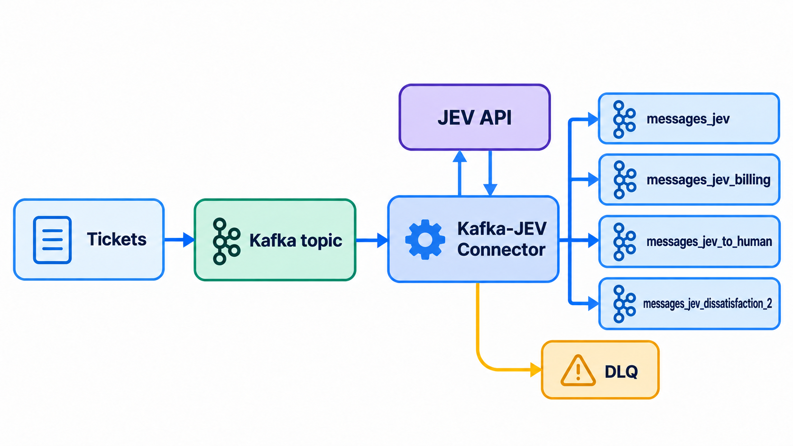
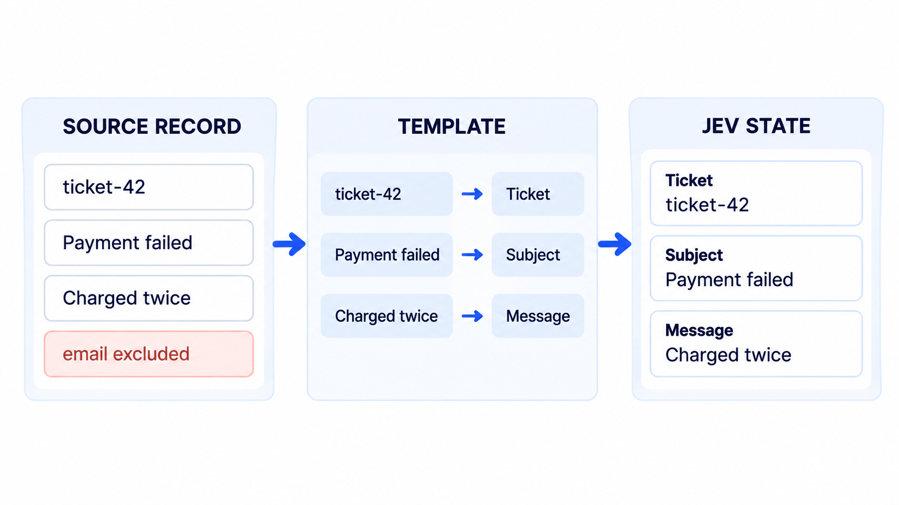
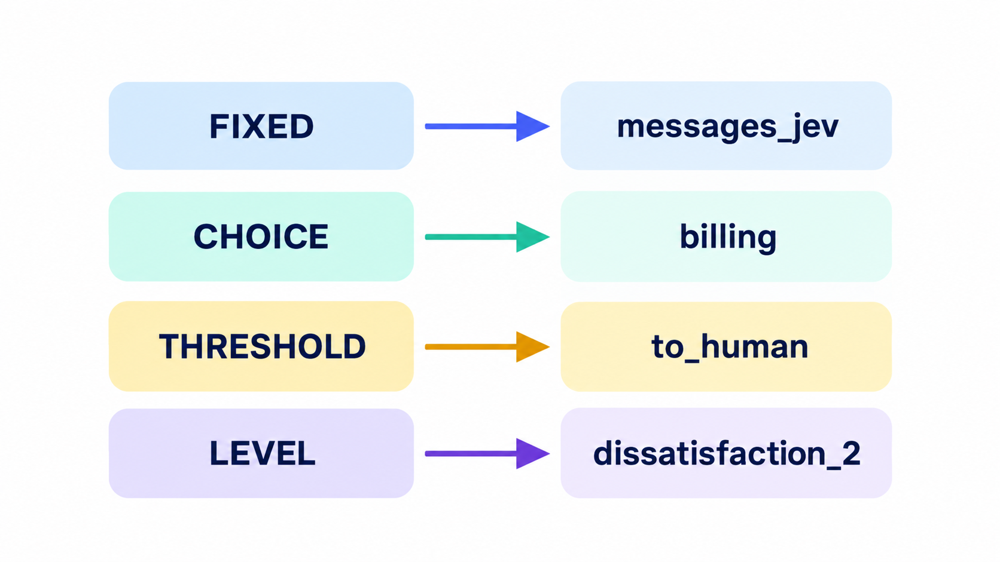
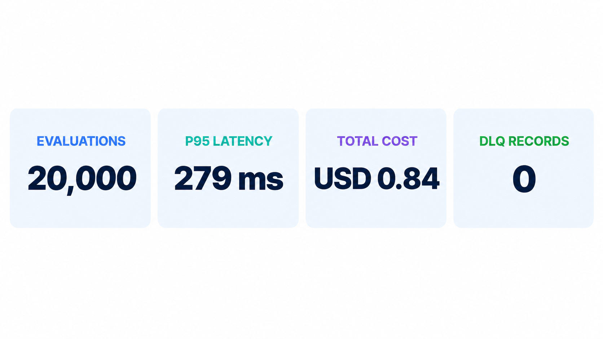

Most event-driven AI use cases do not begin with text generation. They begin with a decision:

- Is this event urgent?
- Does it require a person?
- Which team owns it?
- Does it look like fraud?
- Which workflow should run next?

Automating these small decisions is what lets a business process scale.

That is the problem I wanted to solve by connecting Kafka to JEV.

In this post, we will build a pipeline that:

- consumes support tickets from Kafka;
- classifies each ticket with JEV;
- enriches the original event with the answers;
- routes the result to a topic selected from those answers; and
- measures latency and cost across 20,000 evaluations.

All code and configuration are available in the [Kafka JEV demo repository](https://github.com/smatiolids/kafka_jev_demo).

## The Kafka-JEV connector

I built [Kafka-JEV-Connector](https://github.com/smatiolids/kafka-jev-connector) as an open-source Kafka Connect sink connector.

It consumes records from selected topics, builds a state from each record, submits that state and a set of questions to JEV, and publishes an enriched record.

The destination can be fixed or derived from a JEV answer. In the second case, the connector also acts as a message router.



Failures can be sent to a dead-letter queue. Successful evaluations produce one output record in one destination topic.

## The example: route support tickets

The demo reads support tickets from a CSV file and publishes them to a `messages` topic.

The connector evaluates each ticket, enriches it, and writes the result to a topic whose name starts with `messages_jev`.

Before configuring Kafka Connect, we need to define two things:

1. **Questions:** what do we want the model to decide?
2. **State:** which event data does the model need to make those decisions?

### Define the questions

The question set covers human intervention, cancellation risk, department, customer intent, urgency, and dissatisfaction.

It combines `noul`, `choice`, and `score` questions so the routing examples can use continuous values, named choices, and ordered levels.

The criteria and answer keys are part of the routing contract. For example, the `department` choices become topic suffixes, while urgency scores can be compared with a business-defined threshold.

The questions live in `config/questions.json`. A helper script serializes them into the Kafka Connect configuration:

```bash
python3 config/set_questions.py
```

### Build the model state

If questions define what we want to know, state defines what JEV needs to know.

The connector can send the complete record value:

```json
{
  "state.mode": "FULL_VALUE"
}
```

That is convenient, but an event may contain irrelevant or sensitive fields. Raw JSON may also provide less context than a short, labeled description.

The demo therefore uses `TEMPLATE` mode:

```json
{
  "state.mode": "TEMPLATE",
  "state.template": "Ticket: ${key}\nSubject: ${value:/subject:-(no subject)}\nMessage: ${value:/body:-(no message)}"
}
```

For a record with key `ticket-42`, subject `Payment failed`, and body `My card was charged twice`, JEV receives:

```text
Ticket: ticket-42
Subject: Payment failed
Message: My card was charged twice
```

This gives each value a meaning and controls which fields leave Kafka.



Templates can read the complete key or value, JSON Pointer fields, headers, and Kafka metadata:

| Expression | Content |
| --- | --- |
| `${value}` | Complete record value |
| `${key}` | Complete record key |
| `${value:/customer/name}` | Value field selected by JSON Pointer |
| `${key:/tenant/id:-unknown}` | Key field with a default |
| `${header:trace-id}` | Last header with this name |
| `${metadata:topic}` | Source topic |
| `${metadata:partition}` | Source partition |
| `${metadata:offset}` | Source offset |
| `${metadata:timestamp}` | Record timestamp |

The `:-` fragment provides a fallback. Without one, a missing reference is a permanent failure and the connector sends the record to the DLQ.

Template mode turns each event into focused, dynamic context without requiring another custom consumer.

## Configure the connector

With the questions and state defined, the core connector configuration looks like this:

```json
{
  "connector.class": "io.github.smatiolids.kafkajev.JevSinkConnector",
  "tasks.max": "1",
  "topics": "messages",
  "output.topic": "messages_jev",
  "errors.deadletter.topic": "messages_jev_dlq",
  "output.bootstrap.servers": "${env:KAFKA_BOOTSTRAP_SERVERS}",
  "jev.api.key": "${env:TYPESAFE_API_KEY}",
  "jev.endpoint": "https://api.typesafe.ai/v1/systemone",
  "jev.model": "jev-latest",
  "question.set.id": "message_classification/v1",
  "state.mode": "TEMPLATE",
  "state.template": "Ticket: ${key}\nSubject: ${value:/subject:-(no subject)}\nMessage: ${value:/body:-(no message)}",
  "behavior.on.null.values": "IGNORE"
}
```

`topics` selects the input. `errors.deadletter.topic` selects the failure destination. Despite its singular name, `output.topic` can also be a template that selects the success destination.

The connector does not create topics. Provision every possible destination before processing records.

## Four routing patterns

The same enriched record can support several routing policies.



### 1. Send everything to one topic

The simplest policy uses a fixed topic:

```json
{
  "output.topic": "messages_jev"
}
```

Every successful result goes to `messages_jev`. The answers enrich the event but do not affect its route.

### 2. Route by a choice

We can insert the selected department into the topic name:

```json
{
  "output.topic": "messages_jev_${answers.department.choice}"
}
```

A `billing` result goes to `messages_jev_billing`; `technical_support` goes to `messages_jev_technical_support`.

Here, JEV does more than label the ticket. Its answer selects the workflow that receives it.

### 3. Route by a threshold

For a `noul` answer, the routing rule can compare its value with a business threshold:

```json
{
  "output.topic": "messages_jev_${answers.requires_human.noul > 0.8; \"to_human\", \"to_agent\"}"
}
```

Values above `0.8` go to `messages_jev_to_human`. All other values go to `messages_jev_to_agent`.

The model produces the value; our rule chooses the cutoff. We can make the policy more conservative when a wrong automated route has greater impact.

The same pattern works with a continuous score:

```json
{
  "output.topic": "messages_jev_${answers.urgency.score > 2 ; \"urgent\", \"normal\"}"
}
```

This rule routes tickets to either `messages_jev_urgent` or `messages_jev_normal`.

### 4. Route by a score level

We can also preserve each level of the original scale:

```json
{
  "output.topic": "messages_jev_dissatisfaction_${answers.customer_dissatisfaction.level}"
}
```

With four criteria, the possible topic suffixes are `0`, `1`, `2`, and `3`.

Each evaluation still produces one publication. The connector selects one destination; it does not fan out the result to several topics.

## Run the demo locally

Create `.env` from the repository example and set `TYPESAFE_API_KEY`. Then start Kafka and Kafka Connect:

```bash
docker compose -f compose.kafka.yaml -f compose.yaml up -d --build --wait
```

Check the connector status:

```bash
curl --fail --silent localhost:8083/connectors/jev/status
```

Create a virtual environment, install the helper dependencies, and send ten tickets:

```bash
python3 -m venv .venv
.venv/bin/pip install -r requirements.txt
.venv/bin/python helper/send_message.py --limit 10
```

Each ticket triggers one JEV call, so starting with a small batch is useful.

Follow every output topic with:

```bash
.venv/bin/python helper/receive_messages.py --from-beginning --pretty
```

To try another routing policy, change `CONNECTOR_CONFIG_FILE` in `.env` to one of the `connector-local*.json` files and restart the connector environment.

## Results from 20,000 evaluations

I ran all 4,000 tickets through each of the five output configurations.

That produced 20,000 enriched records, plus the 4,000 original input events. Every evaluation used the resolved model `jev-1.14.0`.



### Routing distributions

Each policy processed the same dataset but exposed a different operational view:

| Policy | Distribution |
| --- | --- |
| Fixed | 4,000 in `messages_jev` |
| Department | 3,237 technical support; 414 billing; 341 general support; 7 account security; 1 retention |
| Human intervention | 2,203 to agent; 1,797 to human |
| Urgency | 2,427 normal; 1,573 urgent |
| Dissatisfaction | 927 at level 0; 1,945 at level 1; 1,128 at level 2; none at level 3 |
| DLQ | No records |

Each policy ran a fresh evaluation. Because results are not deterministic, small differences between runs are expected.

The average `requires_human` value was `0.74`. At a threshold of `0.5`, 90.1% of tickets would be true.

Our stricter `0.8` rule sent 1,797 tickets to a person and allowed 2,203 to continue to an agent.

Urgency shows the same model-versus-policy separation. With `score > 2`, 1,573 tickets, or 39.3%, entered the urgent path.

### Latency and reliability

Across the 20,000 calls, observed JEV latency was:

| Metric | Latency |
| --- | ---: |
| Average | 210 ms |
| p50 | 201 ms |
| p95 | 279 ms |
| p99 | 329 ms |
| Maximum | 1,518 ms |

All evaluations succeeded on the first attempt. No records were retried or sent to the DLQ.

This is one test on one workload, not a universal benchmark. It does show the profile we were looking for: structured per-event decisions with a p95 below 300 ms in this run.

### Cost

The run consumed 20,002,245 input tokens and 3,737,920 output tokens, averaging 1,187 total tokens per record.

At the JEV rate used for this test—USD 0.042 per million input tokens—the complete run cost about USD 0.84.

| Projection | Estimated cost |
| --- | ---: |
| One evaluation | USD 0.000042 |
| 1,000 evaluations | USD 0.042 |
| 1 million evaluations | USD 42.00 |

Pricing changes, so treat these figures as a record of the test rather than a current quote.

We evaluated the same 4,000 tickets five times. A single pass under the same conditions would cost about USD 0.17.

You can inspect the [complete captured results](https://github.com/smatiolids/kafka_jev_demo/blob/main/docs/results.txt) or reproduce the summary locally:

```bash
.venv/bin/python helper/summarize_results.py
```

## What I learned

The interesting boundary is not between "AI" and "no AI." It is between the model's assessment and the business policy that acts on it.

JEV can estimate whether a ticket needs a person, how urgent it is, or which department fits best. Kafka Connect can turn that estimate into a repeatable route with explicit thresholds and failure handling.

This pattern is useful when you need to classify, prioritize, or route events but do not need to generate prose.

It keeps the decision output structured, the business threshold visible, and the event pipeline composable.

If you want to try it, clone the [demo](https://github.com/smatiolids/kafka_jev_demo) and explore the [connector source](https://github.com/smatiolids/kafka-jev-connector).

If the project is useful, a GitHub star is always appreciated.
